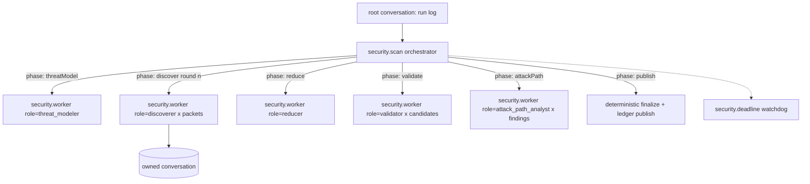

## Context

See `proposal.md`. The current package has three orchestration engines and three state systems (see the table below), all persisted through a Python SQLite workbench reached by one subprocess per mutation.

| Path | Orchestrator | Model invocation | State |
|---|---|---|---|
| Standard / Diff | Skill prose in the host Pi session | `pi-subagents` event-bus RPC | `scans`, `scan_progress`, handoff claims |
| Canonical CLI | `src/workflow/scheduler.ts` | `pi --mode rpc` per phase attempt | `workflow_*` tables |
| Deep Scan | `src/deep-scan/coordinator.ts` | in-process `createAgentSession` | `deep_scan_*` tables, `worker-continuation.json` |

pi-durable 1.4.0 facts this design depends on (verified against source):

- One process owns a storage. There is no cross-process lock; `SqliteStorage` mints IDs in memory.
- Tasks are phase state machines. A phase reruns from its top after a crash and must commit a changed checkpoint.
- Joins are `failFast` or `allSettled` only. There is no "any settled" join.
- No concurrency limit: every runnable task starts in one scheduler pass.
- No task wall-clock timeout. `sleepUntil` plus `abortTask` builds one.
- Tools default to `replay: "unsafe"`: a crash mid-call yields an `interrupted` error result, not a rerun.
- `NodeExecutionEnv` is not a confinement boundary: it follows absolute paths, `~`, and symlinks, and inherits `process.env`.
- Hooks apply only in conversations that select their extension.
- Tasks can own conversations (`runtime.conversation(id)`) and drive them with `submit({ requestId })`. Waiting on a submission is in memory; a rerun finds the same submission by `requestId`.
- `pi-coding-agent` exports `ModelRuntime`, which `implements Models` and reads Pi `auth.json`.
- No model-level structured output. Structured results come back through tools with `structuredOutputSchema` or tools that write documents.

## Goals / Non-Goals

**Goals:**

- One orchestration model for Standard, Diff, Deep, Fix, and Verify.
- Crash-safe resume with no hand-written leases, heartbeats, continuation files, or claim tokens.
- Keep or strengthen target confinement, credential isolation, scan integrity, and honest coverage.
- Byte-compatible scan outputs and finding fingerprints with the current Python implementation.
- A TypeScript-only runtime.

**Non-Goals:**

- Multi-process writers to one run, remote execution, a daemon, or a central service.
- Running scans inside the interactive Pi session's agent loop.
- Codemode or tool search for workers.
- Migrating the legacy workbench database.
- User-composable workflow graphs.

## Decisions

### D1. Standalone runtime; the Pi extension is a client

The CLI process hosts the Harness. The Pi extension starts the CLI as a detached child for a run and observes it by opening the run storage with `readOnly: true`. Hosting a Harness inside the Pi process would make runs invisible to Pi's UI anyway, would tie scan lifetime to the Pi session, and would put two agent runtimes in one process.

Alternative: host the Harness inside the extension. Rejected: there's no shared UI, lifetime coupling, and lock contention with a CLI started on the same run.

### D2. One Harness and one SQLite file per run

Layout under `$PI_SECURITY_STATE_DIR` (default `$PI_HOME/security`):

```text
runs/<run-id>/
  run.lock           exclusive writer lock (pid, host, started-at)
  run.sqlite         pi-durable storage (WAL)
  scan/              scan-directory output contract (manifest, findings, coverage, report, exports)
  worktree/          fix runs only
ledger.sqlite        findings ledger (D8)
```

Concurrent scans never contend for a writer. Resume is "acquire lock, `Harness.open`, `resume()`". Deleting a run is deleting its directory. A run's lock is taken before `Harness.open` and released after `harness.close`. A stale lock (dead pid on the same host) can be broken; a lock from another host is never broken automatically.

Alternative: one global durable database. Rejected because it serializes every pi-security process on one lock.

### D3. Task model



- `security.scan` (orchestrator task, owned by the root conversation). Phases: `preflight → inventory → threatModel → plan → discover → reduce → validate → attackPath → report → publish`. Deterministic phases (`preflight`, `inventory`, `plan`, `publish`) are plain TypeScript and must be idempotent, because a phase reruns after a crash. Model phases create `security.worker` child tasks in one commit and return `{ status: "waiting", on, policy: "allSettled" }`.
- `security.worker` (child task). Phase `open` creates an owned conversation configured for its role (model, thinking, extensions, tools, instructions, cwd) and commits its ID in the checkpoint. Phase `run` submits the packet with `requestId: "worker:<taskId>"`, waits, reads the role's result document, and commits a terminal outcome. A crash during `run` reruns it, and `requestId` returns the same submission. Workers retry their own model failures through generation `settings.retry`. A worker that ends without a valid result fails, and the orchestrator decides what to do with failed workers per phase (D6).
- `security.deadline` (background child of the orchestrator). Sleeps with `sleepUntil(deadline)`, then aborts the orchestrator with reason `deadline`. This is the run's wall-clock limit.
- Results never live in task-scoped documents, which retire with their task. Each role writes to a session-scoped document family keyed by worker task ID (`security.result/<taskId>`), committed by its report tool together with the tool result.

Alternative: direct model calls in tasks without a tool loop. Rejected: discovery and validation need to explore the repository.

### D4. Bounded fan-out in waves

pi-durable starts every runnable task at once and has no "any settled" join. The orchestrator therefore creates at most `max_parallel` workers per commit, waits `allSettled`, and creates the next wave in the next phase step. Checkpoint: `{ phase, round, pending: PacketId[], wave: TaskId[] }`.

The cost is that stragglers idle the slots in their wave. Two follow-ups, recorded as open questions: an upstream `anySettled` join, or worker-side slot gating through a session document. Waves ship first because they are simple and obviously correct.

### D5. Models and credentials

`ModelRuntime.create({ authPath: <pi agent dir>/auth.json, modelsPath, refreshOnCreate: false })` is passed as `HarnessOptions.models`. TOML `[roles.<id>]` selects provider, model, and thinking. The inline `credential = { value = ... }` form is removed. A role may name an environment variable through `credential = { env = "NAME" }`, applied as a `ModelRuntime` runtime API key for that provider. Credentials never enter durable storage: model choices are stored per conversation in `pi.agent` as names only, and keys are resolved per request.

### D6. Phase failure policy

| Phase | Worker failures | Run outcome |
|---|---|---|
| threatModel | one worker; failure fails the run | failed |
| discover | tolerated; recorded as coverage gaps | continues; coverage incomplete if any packet failed |
| reduce | one worker; one retry by re-creating the task; then fail | failed |
| validate / attackPath | tolerated per candidate; candidate stays `unvalidated` | continues; finding marked unvalidated |
| publish | deterministic; a throw faults the task | failed (parked after restart limit) |

Only a run whose orchestrator completes with no coverage gaps may claim complete coverage (the existing honest-coverage rule).

### D7. Confinement is in the environment and the tool set, not in hooks

Hooks can be deselected by a conversation's extension selection, so mandatory policy lives where a conversation can't remove it:

- `HarnessOptions.env` returns a `ConfinedEnv` that wraps a Node file system implementation with the existing verified-handle rules ported from `execution-boundary.ts`: repo-relative paths only, `O_NOFOLLOW` opens, fd identity checks, artifact roots outside the target. `exec` is refused unless the role grants it (D10).
- Workers are offered only package tools (`list_files`, `read_source`, `search_source`, `git_metadata`, `get_context`, and their role's `report_*` tool). The built-in `read`/`write`/`edit`/`bash` are never installed in scan runs. Each role's tool list is set with `configure({ extensions: [...], tools: [...] })` at conversation creation, as an exact array.
- The orchestrator re-verifies a worker conversation's resolved agent (`runtime.agent`) before admitting its result, so tool expansion through configuration drift fails closed.

### D8. Findings ledger

`ledger.sqlite` is a plain `node:sqlite` database, outside pi-durable, with short `BEGIN IMMEDIATE` transactions so separate run processes can publish safely. Tables: `findings` (fingerprint identity, ported from `workbench_findings.py`), `occurrences` (finding × run × location), `triage_events` (append-only), `remediations` (finding × fix run × verify run × status). The `publish` phase writes the run's findings keyed by run ID, using `INSERT ... ON CONFLICT DO NOTHING`, so a rerun after a crash is a no-op.

Alternative: put the ledger in a durable database. Rejected: durable allows one writer per storage, and the ledger is shared across runs.

### D9. Python port with a parity gate

The port order follows the dependency order of the output contract: finding identity and fingerprints → candidate normalization → inventory → finalizer, sealing, and SARIF → report projection → preflight → patch-risk validator. Each step lands with a parity test that runs the Python and the TypeScript on the same synthetic fixtures and asserts byte-equal JSON (after key-order normalization), byte-equal SARIF, and identical fingerprints. Python is deleted only once every parity test passes, in one dedicated commit.

### D10. Remediation runs

`security.fix` (orchestrator) phases: `prepare` (create `git worktree add -b pi-security/fix/<finding-id>-<run-short> runs/<id>/worktree <base>`; idempotent by checking for the branch first) → `fix` (one worker with role `fixer`) → `test` (run allowlisted commands) → `finalize` (commit in the worktree, write `fix.patch`, record in the ledger).

- The `fixer` role gets `read_source`, `search_source`, `edit_file`, `write_file` (confined to the worktree), and `run_check`.
- `run_check` takes a check name, not a command. Commands come from `[remediation.checks]` in TOML (for example `test = ["npm", "test"]`) and run with argv (no shell), `cwd` set to the worktree, `inheritEnv: false`, and a minimal environment (`PATH`, `HOME` set to a run-private directory, `LANG`). It is declared `replay: "safe"`.
- The user's checkout is never written. Applying the branch is the user's action.
- `security.verify` is a Diff-mode scan of the fix branch against its base, plus a targeted re-validation of the original finding. Its result updates the ledger's remediation status.

Executing repository code is a new trust step. It is opt-in per check and documented as running the target's code as the current user.

### D11. Observation and the Pi extension

- `pi-security run watch <id>` opens the run read-only and renders `watchTaskGraph()` plus the orchestrator's progress document.
- The extension starts runs by spawning the CLI detached (`pi-security scan ... --detach --json`) and observes the same way. Tools: `security_scan`, `security_run`, `security_cancel`, `security_findings`, `security_triage`, `security_fix`. Cancellation from a viewer is a request written to the run directory (`cancel.request`) that the owning process watches and turns into `abortTask(orchestrator)`, because a read-only viewer cannot write to the run storage.

### D12. Durable API isolation

All imports from `@earendil-works/pi-durable` and `@earendil-works/chord` live under `src/durable/`. The dependency is pinned exactly. Upgrades are explicit changes that run the full suite plus a crash-injection suite: kill the process at every commit boundary of a faux-provider scan, then resume, and assert the same outputs.

## Risks / Trade-offs

- **API churn.** pi-durable shipped 8 releases in its first 3 weeks, several with breaking changes. Mitigated by D12. Accepted.
- **Port regressions.** Silent fingerprint drift would re-key findings. Mitigated by D9; with no migration, drift would mostly cost duplicate findings in new ledgers.
- **Transcript persistence.** Every tool output is stored in `run.sqlite`, including repository content a tool returned. Run directories are created `0700` and files `0600`. Package tools return no environment contents, and the credential-redaction pass from `execution-config.ts` is applied in an `afterTool` hook as defense in depth (not as the primary control).
- **Wave inefficiency.** See D4.
- **Executing target code in fix runs.** Opt-in and allowlisted; the environment is scrubbed, but this is not a sandbox. Documented.
- **Synchronous SQLite.** `node:sqlite` blocks the event loop per statement; acceptable for a CLI.

## Open Questions

1. Should the run's wall-clock deadline default to unlimited (today's Deep default is 96 h)?
2. Waves versus sliding window (D4): ask upstream for `anySettled`?
3. Should Diff mode accept only revisions, or keep the working-tree digest target?
4. Should `security.verify` start automatically after a successful fix run?
5. Do skills ship at all in v0.2, or does the extension expose only slash commands that call the tools?
