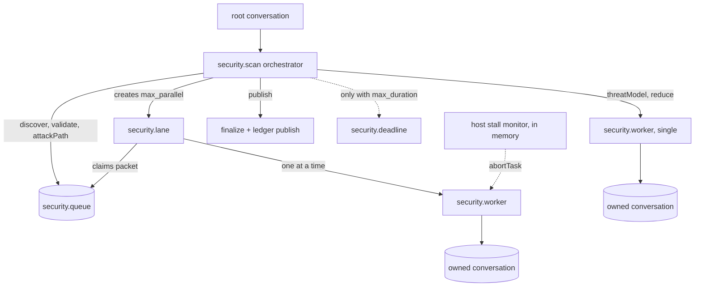

## Context

See `proposal.md`. The current package has three orchestration engines and three state systems (see the table below), all persisted through a Python SQLite workbench reached by one subprocess per mutation.

| Path | Orchestrator | Model invocation | State |
|---|---|---|---|
| Standard / Diff | Skill prose in the host Pi session | `pi-subagents` event-bus RPC | `scans`, `scan_progress`, handoff claims |
| Canonical CLI | `src/workflow/scheduler.ts` | `pi --mode rpc` per phase attempt | `workflow_*` tables |
| Deep Scan | `src/deep-scan/coordinator.ts` | in-process `createAgentSession` | `deep_scan_*` tables, `worker-continuation.json` |

pi-durable 1.4.0 facts this design depends on (verified against source):

- One process owns a storage. There is no cross-process lock; `SqliteStorage` mints IDs in memory.
- Tasks are phase state machines. A phase reruns from its top after a crash and must commit a changed checkpoint.
- Joins are `failFast` or `allSettled` only. There is no "any settled" join.
- No concurrency limit: every runnable task starts in one scheduler pass.
- No task wall-clock timeout. `sleepUntil` plus `abortTask` builds one.
- Tools default to `replay: "unsafe"`: a crash mid-call yields an `interrupted` error result, not a rerun.
- `NodeExecutionEnv` is not a confinement boundary: it follows absolute paths, `~`, and symlinks, and inherits `process.env`.
- Hooks apply only in conversations that select their extension.
- Tasks can own conversations (`runtime.conversation(id)`) and drive them with `submit({ requestId })`. Waiting on a submission is in memory; a rerun finds the same submission by `requestId`.
- `pi-coding-agent` exports `ModelRuntime`, which `implements Models` and reads Pi `auth.json`.
- No model-level structured output. Structured results come back through tools with `structuredOutputSchema` or tools that write documents.

## Goals / Non-Goals

**Goals:**

- One orchestration model for Standard, Diff, Deep, Fix, and Verify.
- Crash-safe resume with no hand-written leases, heartbeats, continuation files, or claim tokens.
- Keep or strengthen target confinement, credential isolation, scan integrity, and honest coverage.
- Byte-compatible scan outputs and finding fingerprints with the current Python implementation.
- A TypeScript-only runtime.

**Non-Goals:**

- Multi-process writers to one run, remote execution, a daemon, or a central service.
- Running scans inside the interactive Pi session's agent loop.
- Codemode or tool search for workers.
- Migrating the legacy workbench database.
- User-composable workflow graphs.

## Decisions

### D1. Standalone runtime; the Pi extension is a client

The CLI process hosts the Harness. The Pi extension starts the CLI as a detached child for a run and observes it without opening its storage for writing (mechanism: Open Question 2). Hosting a Harness inside the Pi process would make runs invisible to Pi's UI anyway, would tie scan lifetime to the Pi session, and would put two agent runtimes in one process.

Alternative: host the Harness inside the extension. Rejected: there's no shared UI, lifetime coupling, and lock contention with a CLI started on the same run.

### D2. One Harness and one SQLite file per run

Layout under `$PI_SECURITY_STATE_DIR` (default `$PI_HOME/security`):

```text
runs/<run-id>/
  run.lock           exclusive writer lock: a SQLite file held in an EXCLUSIVE transaction
  run.owner          who holds the lock (pid, host, started-at), for messages only
  run.sqlite         pi-durable storage (WAL)
  scan/              scan-directory output contract (manifest, findings, coverage, report, exports)
  worktree/          fix runs only
ledger.sqlite        findings ledger (D8)
```

Concurrent scans never contend for a writer. Resume is "acquire lock, `Harness.open`, `resume()`". Deleting a run is deleting its directory. A run's lock is taken before `Harness.open` and released after `harness.close`. The lock is SQLite's operating-system file lock, which the kernel releases when the holder exits however it exits, so there is no stale lock to detect or break and no PID-reuse ambiguity. (A pid/host lock file was tried first: breaking a stale one by moving it aside leaves a moment with no lock file, in which a third process can take the lock while the second restores the one it moved.)

Alternative: one global durable database. Rejected because it serializes every pi-security process on one lock.

### D3. Task model



- `security.scan` (orchestrator task, owned by the root conversation). Phases: `preflight → inventory → threatModel → plan → discover → reduce → validate → attackPath → report → publish`. Deterministic phases (`preflight`, `inventory`, `plan`, `publish`) are plain TypeScript and must be idempotent, because a phase reruns after a crash. Model phases create `security.worker` child tasks in one commit and return `{ status: "waiting", on, policy: "allSettled" }`.
- `security.worker` (child task). Phase `open` creates an owned conversation configured for its role (model, thinking, extensions, tools, instructions, cwd) and commits its ID in the checkpoint. Phase `run` submits the packet with `requestId: "worker:<taskId>"`, waits, reads the role's result document, and commits a terminal outcome. A crash during `run` reruns it, and `requestId` returns the same submission. Workers retry their own model failures through generation `settings.retry`. A worker that ends without a valid result fails, and the orchestrator decides what to do with failed workers per phase (D6).
- **Stall monitor (host, in memory, not a task).** pi-durable stores no timestamps on entries or `pi.live` (spike 0.4), so the process that owns the run watches the task graph for `security.worker` nodes, watches each worker conversation, stamps every change with its own clock, and calls `harness.abortTask()` on a worker with no change for `stall_timeout` (default 15 minutes). Streamed partials commit about every 100 ms, so an active response never looks stalled. It needs no durability: after a restart every worker legitimately starts with a fresh stamp. The lane that owns a stalled worker re-creates it once; a second stall is a worker failure under D6. The same monitor enforces `max_cost` (D13).
- `security.deadline` (background child of the orchestrator, created only when `max_duration` is set). It sleeps with `sleepUntil(start + max_duration)`, then aborts the orchestrator with reason `duration_limit`. It is durable, so the deadline survives restarts.
- **Run creation is idempotent.** The command that starts a run creates the orchestrator and stores its ID in the `security.run` session document in one commit, and every open reads that document first (spike 0.1: a crash before this commit otherwise leaves a run directory with no orchestrator).
- Results never live in task-scoped documents, which retire with their task. Each role writes to a session-scoped document family keyed by the worker's conversation ID (`security.result/<conversationId>`), committed by its report tool together with the tool result. (A tool call's `api.taskId` is the tool task, not the worker; the worker records its conversation ID in its checkpoint, so the orchestrator finds the result from that.) Report tools take the role's checked-in schema (dereferenced, without workbench identity fields such as `scanId`) as their parameters, so pi-durable validates each payload before the tool runs, and the orchestrator re-validates admitted results with the same pi-ai validator. That validator applies standard JSON Schema `pattern` search semantics; the finalizer's Python-compatible validator uses `fullmatch`, which these schemas do not intend.

Alternative: direct model calls in tasks without a tool loop. Rejected: discovery and validation need to explore the repository.

### D4. Bounded fan-out with lanes

pi-durable starts every runnable task at once and offers only `failFast` and `allSettled` joins. Waves (create `max_parallel` workers, wait for all, repeat) were measured at 2.3–2.4× the wall time of an ideal sliding window with long-tailed worker latency (spike 0.3), and are rejected.

Lanes give a sliding window from the existing primitives, without polling:

- A fan-out phase writes its packets to a `security.queue` session document and creates `min(max_parallel, packets)` `security.lane` child tasks in one commit, then waits `allSettled` on the lanes.
- A lane's `claim` phase takes the next packet from the queue in the same commit that creates its worker, then waits `allSettled` on that one worker. Its `collect` phase records the outcome in the queue (re-creating the worker once after a stall or a replaceable failure) and returns to `claim`. A lane ends when the queue is empty.
- Lanes matched the simulated ideal within 0.5% and passed the crash-at-every-commit test (spike 0.1, 0.3).

An upstream `anySettled` join would remove the lane tasks but isn't needed.

### D5. Models and credentials

`ModelRuntime.create({ authPath: <pi agent dir>/auth.json, modelsPath, refreshOnCreate: false })` is passed as `HarnessOptions.models`. TOML `[roles.<id>]` selects provider, model, and thinking. The inline `credential = { value = ... }` form is removed. A role may name an environment variable through `credential = { env = "NAME" }`, applied as a `ModelRuntime` runtime API key for that provider. Credentials never enter durable storage through requests: model choices are stored per conversation in `pi.agent` as names only, and keys are resolved per request (spike 0.2: an `auth.json` key reached the provider and appeared in no SQLite file).

Provider error bodies are stored verbatim, though: a 401 that echoed the key put it into `run.sqlite` as the submission's detail (spike 0.2). `HarnessOptions.models` is therefore a decorator over `ModelRuntime` that removes every known credential value (from `auth.json`, role `credential.env` variables, and the provider environment variables `ModelRuntime` would read) from `error`/`done` events and from `completeSimple`/`fetchDeferred` results. The spike's version fixed the leak without affecting normal answers. OAuth credentials and refresh were not testable in the spike and need a manual check.

### D6. Phase failure policy

| Phase | Worker failures | Run outcome |
|---|---|---|
| threatModel | one worker; failure fails the run | failed |
| discover | tolerated; recorded as coverage gaps | continues; coverage incomplete if any packet failed |
| reduce | one worker; one retry by re-creating the task; then fail | failed |
| validate / attackPath | tolerated per candidate; candidate stays `unvalidated` | continues; finding marked unvalidated |
| publish | deterministic; a throw faults the task | failed (parked after restart limit) |

Only a run whose orchestrator completes with no coverage gaps may claim complete coverage (the existing honest-coverage rule).

### D7. Confinement is in the environment and the tool set, not in hooks

Hooks can be deselected by a conversation's extension selection, so mandatory policy lives where a conversation can't remove it:

- Package tools read the target through `ConfinedRoot` (`src/target/confined-root.ts`), the rules ported from `execution-boundary.ts`: paths relative to the root (or absolute inside it) and inside the scan scope, no symbolic link in any component, `O_NOFOLLOW` opens with descriptor identity checks; run state is kept outside the target (`isInsideDirectory`).
- `HarnessOptions.env` returns a `ConfinedEnv` (`src/durable/confined-env.ts`) for every conversation: an `ExecutionEnv` whose reads are verified by `ConfinedRoot` and then served by pi-durable's `NodeExecutionEnv` without following links, and which refuses writes, temporary files, watching, and `exec`. pi-durable passes the env only to prompt sections and tools, so this covers any tool that expects an environment. The fixer's worktree writes (D10) arrive with that role. pi-durable's `registerEnvConformance` assumes a writable root, a shell, watching, and link following, all of which confinement refuses, so a differential test against `NodeExecutionEnv` for permitted reads takes its place.
- Workers are offered only package tools (`list_files`, `read_source`, `search_source`, `git_metadata`, `get_context`, and their role's `report_*` tool). `git_metadata` returns the target binding the orchestrator resolved at preflight (D14) rather than parsing the untrusted repository's `.git`. The built-in `read`/`write`/`edit`/`bash` are never installed in scan runs. Each role's tool list is set with `configure({ extensions: [...], tools: [...] })` at conversation creation, as an exact array.
- The orchestrator re-verifies a worker conversation's resolved agent (`runtime.agent`) before admitting its result, so tool expansion through configuration drift fails closed.

### D8. Findings ledger

`ledger.sqlite` is a plain `node:sqlite` database, outside pi-durable, with short `BEGIN IMMEDIATE` transactions so separate run processes can publish safely. Tables: `findings` (fingerprint identity, ported from `workbench_findings.py`), `occurrences` (finding × run × location), `triage_events` (append-only), `remediations` (finding × fix run × verify run × status). The `publish` phase writes the run's findings keyed by run ID, using `INSERT ... ON CONFLICT DO NOTHING`, so a rerun after a crash is a no-op.

Alternative: put the ledger in a durable database. Rejected: durable allows one writer per storage, and the ledger is shared across runs.

### D9. Python port with a parity gate

The port order follows the dependency order of the output contract: finding identity and fingerprints → candidate normalization → inventory → finalizer, sealing, and SARIF → report projection → preflight → patch-risk validator. Each step lands with a parity test that runs the Python and the TypeScript on the same synthetic fixtures and asserts byte-equal JSON (after key-order normalization), byte-equal SARIF, and identical fingerprints. Python is deleted only once every parity test passes, in one dedicated commit.

### D10. Remediation runs

`security.fix` (orchestrator) phases: `prepare` (create `git worktree add -b pi-security/fix/<finding-id>-<run-short> runs/<id>/worktree <base>`; idempotent by checking for the branch first) → `fix` (one worker with role `fixer`) → `test` (run allowlisted commands) → `commit` (commit in the worktree, write `fix.patch`) → `verify` (D10a) → `finalize` (record the fix and its verdict in the ledger).

Users can run fixes however they like, one at a time or many in parallel. Each fix run is independent: its own storage, worktree, and branch. The branch name carries the run's short ID, so concurrent fixes of the same finding never collide. The ledger handles concurrent publishers (D8).

- The `fixer` role gets `read_source`, `search_source`, `edit_file`, `write_file` (confined to the worktree), and `run_check`.
- `run_check` takes a check name, not a command. Commands come from `[remediation.checks]` in TOML (for example `test = ["npm", "test"]`) and run with argv (no shell), `cwd` set to the worktree, `inheritEnv: false`, and a minimal environment (`PATH`, `HOME` set to a run-private directory, `LANG`). It is declared `replay: "safe"`.
- The user's checkout is never written. Applying the branch is the user's action.
### D10a. Verification is part of the fix run

A fix run cannot finish as fixed without a verdict. Its `verify` phases run the Diff-scan pipeline (`inventory → plan → discover → reduce → validate`) over the fix commit against its base, plus a validator worker that re-checks the original finding against the fixed code. Verdicts: `verified`, `not_fixed`, or `regressed` (the Diff scan admitted a new finding, which is linked to the fix run). `--no-verify` skips verification and records the fix as `unverified`.

One run means one ID, one resume, and one cancel for the whole fix. `pi-security verify <fix-run-id>` remains for re-checking later; it starts a separate `security.verify` run with the same phases.

Executing repository code is a new trust step. It is opt-in per check and documented as running the target's code as the current user.

### D11. Observation and the Pi extension

- `pi-security run watch <id>` renders the task graph and the orchestrator's progress document without opening the storage for writing (Open Question 2).
- The extension starts runs by spawning the CLI detached (`pi-security scan ... --detach --json`) and observes the same way. Tools: `security_scan`, `security_run`, `security_cancel`, `security_findings`, `security_triage`, `security_fix`.
- Slash commands (`/security-scan`, `/security-diff-scan`, `/deep-security-scan`, `/security-fix`, `/security-runs`) call the same code as the tools directly, with no model round trip. Today's pattern of sending a message for a skill to interpret is removed.
- The methodology skills are deleted; their content becomes worker instructions (task 4.7). One interactive skill ships, `triage-finding`: it walks the user through a finding's evidence and options and ends in `security_triage` or `security_fix`. `vulnerability-writeup` may follow as a second skill.
- Cancellation from a viewer is a request written to the run directory (`cancel.request`) that the owning process watches and turns into `abortTask(orchestrator)`, because a read-only viewer cannot write to the run storage.

### D12. Durable API isolation

All imports from `@earendil-works/pi-durable` and `@earendil-works/chord` live under `src/durable/`. The dependency is pinned exactly, and code is written against the published `.d.ts` files: the published 1.4.0 already differs from upstream `main` (no `observeTaskGraph`/`observeConversation`; different watch listener signature). Upgrades are explicit changes that run the full suite plus a crash-injection suite: kill the process at every commit boundary of a faux-provider scan, then resume, and assert the same outputs.

### D13. Run limits

No wall-clock deadline by default: runs fail far more often by hanging than by running long, and the host stall monitor (D3) handles hanging. Standard and Diff scans end on their own; Deep scans end on saturation or `max_discovery_rounds` (default 8). Two optional limits exist (`max_duration` enforced by the durable `security.deadline` task, `max_cost` by the stall monitor), and both end the run `interrupted` with admitted evidence kept and coverage marked incomplete:

- `[execution] max_duration` (a duration string such as `"6h"`)
- `[execution] max_cost` (USD, read from the run's summed `pi.usage`)

### D14. Working-tree Diff scans are snapshot commits

`--base REV` without `--head` scans the working tree. At preflight, the working tree (tracked changes plus untracked, non-ignored files) is written to a commit object through a temporary index without touching the user's index, branch, stash, or files (`src/target/snapshot.ts`). Repository-local config is untrusted, and `git add` would run clean filter drivers it names, so contents are hashed with `hash-object --no-filters`, entered with `update-index --index-info`, and committed with `commit-tree --no-gpg-sign` under a fixed identity and date, so the same `HEAD` and contents always give the same commit. File names containing a newline are rejected. The scan then targets that commit ID exactly like a revision diff. Edits made during the scan cannot change its scope, resume needs no special case, and there is one code path. The snapshot is kept reachable from `refs/pi-security/snapshots/<run-id>` until the run directory is deleted.

## Risks / Trade-offs

- **API churn.** pi-durable shipped 8 releases in its first 3 weeks, several with breaking changes. Mitigated by D12. Accepted.
- **Port regressions.** Silent fingerprint drift would re-key findings. Mitigated by D9; with no migration, drift would mostly cost duplicate findings in new ledgers.
- **Transcript persistence.** Every tool output is stored in `run.sqlite`, including repository content a tool returned. Run directories are created `0700` and files `0600`. Package tools return no environment contents, and the credential-redaction pass from `execution-config.ts` is applied in an `afterTool` hook as defense in depth (not as the primary control).
- **Lane tasks.** One extra task per slot, and the queue document grows with packet count. Packets are small; acceptable.
- **Executing target code in fix runs.** Opt-in and allowlisted; the environment is scrubbed, but this is not a sandbox. Documented.
- **Synchronous SQLite.** `node:sqlite` blocks the event loop per statement; acceptable for a CLI.

## Resolved Questions

1. Deadline: none by default; a host stall monitor plus optional `max_duration` and `max_cost` (D3, D13).
2. Fan-out: lanes, a sliding window built from `allSettled` joins (D4; waves rejected by spike 0.3).
3. Diff scope: working-tree scans stay, implemented as snapshot commits (D14).
4. Verification: part of every fix run unless `--no-verify` (D10a). Users can run fixes however they like.
5. Skills: slash commands call tools directly; one interactive `triage-finding` skill (D11).

## Open Questions

1. OAuth credentials through `ModelRuntime` (spike 0.2 covered API keys only).
2. How viewers observe a run. pi-durable 1.4.0 has no read-only storage open, and `Harness.open` runs a recovery commit, so a viewer must never open the Harness. Candidates: the owning process publishes a progress snapshot file in the run directory (atomic replace) on task-graph and progress changes; the owner serves a local socket; or viewers read the SQLite file directly with `node:sqlite` in read-only mode, which ties them to pi-durable's private schema against D12.
